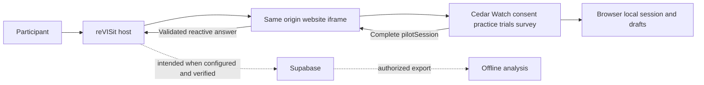

# Cedar Watch integration design

Status 2026-11-07. Iframe is selected and Supabase is chosen. Cedar Watch is the working baseline because the final intended instrument is unknown. The user confirms applicable pilot approvals and certifications; this repository does not independently establish the records. Investigator review and technical release gates remain open. Use synthetic data only until those gates pass. No deployment or production readiness is claimed. See `plan.md` for scientific risks and `tasks.md` for status and acceptance criteria.

## Boundaries and flow

The host owns navigation and the reactive answer. The child owns the existing draft instrument, including separate practice, ten trials and usability survey. `public/global.json` registers the draft and `public/cedar-watch-pilot/StudyConfig.json` defines the website and `pilotSession` response. The iframe child sends a complete session as a JSON string. The host checks the ten-trial and `usability` shape before setting the stimulus valid. This validation is not complete protocol or security verification and is not evidence of a durable write.

The host provides an iframe correlation ID, trial ID and parent origin. It checks message ID, origin and source, uses an explicit target origin and removes its listener. The child overlay requires an exact approved parent origin and matching referrer. Production builds require HTTPS for configured origins and disable HTTP loopback. Child Vite development allows HTTP loopback only with an exact loopback allowlist entry and explicit opt-in; no end-to-end host/dev-server loopback flow has been verified. Without a trusted origin the bridge remains disabled. Complete security and lifecycle review, replay handling, full assignment and answer validation, real browser testing and frame policy verification remain open. Correlation IDs are not authentication.

## Persistence and recovery

Supabase is the selected backend, not a verified deployment. Scoped host storage changes and mocked safety tests cover Supabase download error classification, anonymous sign-in and database initialization failures, and returned errors for participant completion, sequence assignment creation and config-hash updates. These do not establish durable persistence or an exhaustive mutation audit. The host engine uses the `revisit` table and storage bucket. The Pages workflow requires build-time URL and anon key and selects Supabase. No actual study-owned configuration, project, RLS or storage policy has been verified. The public anon key must not be confused with a privileged service-role key, which must never enter client builds. Real isolated staging must verify role-specific permissions, persistence, exports and deletion.

There is no durable-save acknowledgment to the child and no durable-save guarantee. Hosted recovery of existing browser sessions is blocked because identity cannot be safely bound to a host participant. It is not hosted resume. Local standalone incomplete sessions route through practice on resume. Browser clearing does not delete host or central copies. Decide and test save acknowledgment, idempotency, partial records, conflicts, recovery, withdrawal, and deletion before launch. Use `(sessionId, trialId)` as the logical trial key and do not assume trial IDs are globally unique.

The Supabase engine now uses a compare-and-set guard for `_updateSequenceAssignmentFields`: it reads and merges the assignment JSON, updates only if the stored `data` still equals the read value, and reports a conflict when no row is returned. The mocked `highLevelSupabase.spec.ts` exercises detection and an explicit subsequent retry preserving a concurrent change. This is not automatic retry or proof of real backend behavior. Verify JSON equality filtering, returned rows, RLS permissions and concurrent updates against the actual schema and Supabase project. Define how callers surface conflicts and when retries are safe. Other mutation paths, multi-step operations and child localStorage session and draft writes remain outside this guard; cross-tab coordination is not established. Passing mocked tests does not prove system-wide race safety.

Reject and undo-reject span participant data and sequence-assignment mutations. Scoped rollback handling and local consistency tests include reporting rollback failures, but do not make the multi-step operation atomic: rollback itself can fail or race with another writer, leaving partially updated records. Define a backend-appropriate atomic operation or a recoverable, observable reconciliation protocol and test failures at every write and rollback boundary, including concurrency and reused assignments. Separately audit remaining Supabase mutations and storage mutation call sites for ignored errors or unawaited outcomes; propagate failures to callers and prevent false success. Neither work is complete.

## Build and dependencies

`scripts/build-cedar-watch.sh` fetches pinned child source `4b6927b12d212f139d003348b79c912a991bdb8b`, applies the bridge, loopback and tests patches in order and injects a source plus combined overlay hash fingerprint. It builds the child at the host base path, then the host build packages it. The Pages workflow supplies origin and storage settings. Overrides and overlay changes require review and must not silently alter an in-progress protocol. Local builds do not require Supabase and need network access for the pinned child.

Latest user-reported checks: 134 storage tests passed, as did lint and typecheck. Earlier reports recorded 184 targeted storage tests and 14 targeted iframe tests; these are separate runs, not additive or a full-suite claim. The exact pinned packaged child passed typecheck, 21 tests across 3 files and the scripted build, with fingerprint `4b6927b12d212f139d003348b79c912a991bdb8b+bridge-224bc56c6af4a0eb` as reported in the README. Vite emitted large-chunk and Zod annotation warnings. These checks were not rerun for this documentation update. Actual end-to-end testing was skipped, not passed; no deployed Supabase, secure effective RLS, durable acknowledgment or safe hosted resume has been demonstrated. Real deployment verification is blocked pending an actual study-owned project and approved deployment origins. No full host build or deployment is implied by the child build.

## Risks and milestones

- User coordinates investigator review of stimuli, all-first answer ordering, leakage, structurally imbalanced assignment and analysis eligibility before freezing the protocol.
- Complete the selected bridge and run synthetic real-host security and browser tests, including failure and accessibility behavior.
- Verify compare-and-set on the real backend, resolve residual conflicts and reject rollback atomicity, and audit ignored mutation outcomes before relying on storage consistency.
- Configure isolated Supabase staging, verify effective policies and demonstrate durable storage and the user-approved recovery approach. A passing build or enabled RLS alone is insufficient.
- Validate exports, analysis, load, security and deletion. Record source and overlay, artifact, environment and rollback.
- The user has confirmed applicable pilot approvals and certifications. Record applicable conditions and confirm separate release authority; no participant collection until outstanding scientific and technical gates pass.

The repository has no `artifacts/proposal.md` or `artifacts/specs.md`, so consistency with those requested sources cannot be verified. The existing README is the available integration reference, while user decisions govern the current plan.
