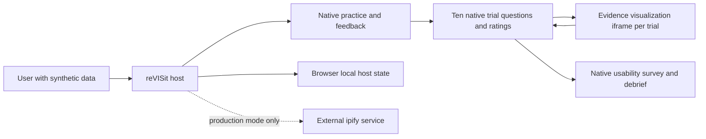
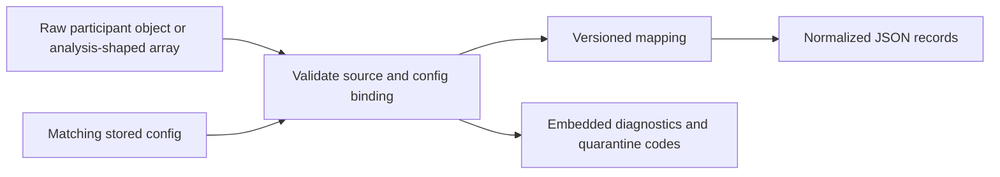

# Cedar Watch synthetic preview design

Status 2026-11-09. This docs-only update inspects the converter, tests, CI configuration and sanitized fixture derived from a local synthetic analysis download. It does not execute tests or independently reproduce the capture. No Supabase work is authorized. The user and README report 22 converter and security tests passed, 4 fixture tests passed, lint and typecheck passed, and the full host suite had 2113 passed, 1 failed and 1 skipped. The failure is reported as a preexisting dynamic-fixture expectation; it is not a clean full-suite pass. These results were not independently rerun here. The fixture and golden test support a narrow synthetic mapping, not general export compatibility or an approved analysis dataset. Earlier option #1 evidence remains historical. The checked-in recipe specifies child commit `898f8af4ddc54a09e4a5b8d9a7766b78600b6e7c` and the sole testing-library patch. The user reports patch application, a successful build, 27 child tests and 90 root tests on rerun, and an independent exact-dist local HTTPS browser pass through ten trials and survey without observed off-origin requests. An earlier separate full host suite reported 2109 passed, 1 failed and 1 skipped; these runs are not additive. No candidate live deployment is reported. This is not a participant-ready study. Fixed group 0, no research consent and browser-local storage only apply, with no demonstrated central durable save. Earlier single-iframe `pilotSession` designs and the prior Supabase collection proposal are historical.

## Boundary and flow

`public/cedar-watch-pilot/StudyConfig.json` defines a fixed sequence: practice, ten trials, usability survey and debrief. Practice uses a fictional example and host-recorded practice answer with feedback. Each trial is a `website` component using `cedar-watch-pilot/app/visualization.html` for evidence only, while the host renders the question, four answer options including `unknown`, confidence and perceived difficulty as sidebar radios. The survey and debrief are host questionnaires. No consent is requested or recorded; a preview acknowledgement is not consent. The frame is not the owner of the trial questions, ratings, practice or survey, and does not submit the old complete `pilotSession` payload in this design.

Each frame receives `contractVersion: 1`, `trialId`, `scenarioFamily`, `taskVariant`, `condition` and `stimulusSeed: 271828` from the host configuration. The sequence explicitly fixes family, variant and condition to group 0, not participant-hashed assignment. The seed controls stimulus configuration, not random assignment. Baseline and recommended views differ in their displayed evidence presentation. The candidate uses upstream source and the sole `scripts/cedar-watch-testing-library.patch`, not the former visualization overlay. The reported local browser pass exercises the happy path; origin/source, frame restrictions and failure paths still need targeted end-to-end verification.

## Candidate provenance and scientific version

The build script requires a full SHA equal to the reviewed pin, rejecting any other override before fetching; changing the allowlist requires review. Both deployment workflow definitions specify that pin. It fetches and checks the commit, checks and applies the single patch, checks the diff and requires source and test markers. The patch modifies the child package manifest and lockfile to pin `@testing-library/dom` at `10.4.1`. `check-cedar-watch-source.mjs` checks markers in their owning bridge, visualization contract, app, Vite and test files rather than accepting a marker elsewhere. Its tests check file ownership, workflow pins, rejection of an unreviewed override and CLI operation with spaces in script and study paths, including invalid input rejection. The user reports 4 guard tests passed; this was not rerun during this documentation update. The lint/build CI workflow runs `yarn test:cedar-build`; configured CI is not proof of a remote pass. Marker presence is not behavioral verification.

The script obtains the actual Git `HEAD^{tree}` ID and SHA-256 of the patch bytes, hashes the exact line `<tree-id>  <patch-sha256>\n` with SHA-256, and takes the first 16 hex characters. It passes `<commit>+testing-library-<16-character-hash>` as `VITE_SOURCE_COMMIT`. Reported candidate inputs are tree `ecedace4ca3ec38fa74ff7fa5d0d3a0a406cb0fe` and patch SHA-256 `683451099d37f879ff703da2316a8b3f6e33b40fd9b5923fe34db1f19ffed74f`, giving reported fingerprint `898f8af4ddc54a09e4a5b8d9a7766b78600b6e7c+testing-library-72815a6ee6386fcc`. The identifier is not the output artifact, host revision, toolchain or settings. The script runs child install, typecheck, tests and build as steps; the reported candidate results are separate from merely inspecting the script.

The reported build environment was Linux arm64 with Node 24, npm 11 and Yarn 1. The reported origin was `https://bobthe88.github.io`, host base `/visualization_revisit_study/`, and child base `/visualization_revisit_study/cedar-watch-pilot/app/`. The temporary candidate artifact was assembled over host `dist`, not demonstrated deployed. Its manifest covers 272 files and hashes to `93abfa3ec2111171b5d74473455bb231dd263b28b2be58b41bc37a7239437250`; the child output manifest covers 6 files and hashes to `fb59158d49e7cd129443afc686aef15d8a4d0cf0dfe3a2972adbd358e9d9b4f6`. For each artifact, order relative paths lexically, write a line `<sha256>  <relative path>\n` for each file, then SHA-256 the manifest. These are reported values, not recomputed for this documentation update.

The reported host base commit was `6acb1e3`; its dirty non-doc source digest was `7ee5d989b3a5fef3f76190c41f95d6283c01663fe842b612bbaf0e127c102333`, derived from the base, binary diff and untracked guard files. This identifies a reported working-tree source state, not a clean commit or deployed artifact. The recorded artifact and its exact-dist browser evidence predate the final guard source change and do not exactly match the final commit. Do not attribute that artifact or browser pass to the final commit without rebuilding and verifying it. No new preview publication is reported. Record the full host commit, source-digest construction details, exact tool versions, test commands and artifact manifest files for independent reproduction. The currently present `dist/index.html` references assets under `/visualization_revisit_study/`, but its identity with the reported temporary artifact is not established. The workflow also derives origin and bases from the repository owner and name; its configuration alone proves neither a run nor a deployment.

The current host-owned fixed-group instrument differs scientifically from the preserved child-owned four-group standalone baseline, including assignment, response ownership and missing interaction and timing data. Neither this pin reconciliation nor the dependency patch establishes scientific equivalence. Compare the actual pinned source and rendered stimuli to the historical baseline, document and version differences and analysis implications, and obtain investigator review before participant use.

In the available sibling source, `vegaSpecFactory.ts` defines an x-interval `timeBrush` on time-chart specifications, with primary-pointer drag, double-click or pointer-cancel clearing, and no translate or zoom. `VegaChart` only registers the callback path when an `onBrush` prop is supplied; the inspected hosted `VisualizationApp` passes selection and readiness handlers but no `onBrush`. Thus an applicable chart can show its internal brush selection without propagating a time range to host-level filtering; the host flow does not capture brush events as trial data. This is a source inspection of the available sibling tree, not independent proof it matches the exact built pinned checkout or that every chart supports brushing. Review the built stimuli and interaction behavior scientifically, including condition differences, before any participant use; do not assert equivalence to the historical baseline.

The existing `IframeController.tsx` has a visualization-specific readiness gate: it initializes stimulus validation as invalid, scopes readiness to the current frame generation and uses checked child readiness messages to update it. This is separate from required native answer gating. It is source-level functionality, not proof that every load, failure, stale message, navigation or refresh path fails closed in the deployed host. Verify those lifecycle paths before collection.

## Data and exports

The host holds separate response IDs for each question and rating, practice, survey and acknowledgement, associated with its own component and participant records. Trial identity and family/variant/condition are in the study configuration and must be joined to the host records using the component and configuration version. An `unknown` value is a response, not an absent answer. Practice is recorded separately and must not be counted as an experimental trial. Visualization selections, interaction samples and child event and timing telemetry are omitted as trial data in this flow. Host `StoredAnswer` separately defines component timestamps and window events, which are not child interactions or validated active time. Do not infer attention, active time or selected reports from host responses.

Host exports differ from the standalone child's session JSON/CSV and its analysis schema. They are not a `pilotSession` record and must not be fed to the existing standalone analysis as if equivalent. A sanitized derivative of a local synthetic analysis download informs the checked-in mapping and golden test; it is not a raw download or an approved analysis dataset.

The synthetic preview stores native host answers in browser localStorage, not Supabase or another central durable store. Browser data may be cleared, unavailable or lost, and any downloaded export is a separate copy. Host progression is not evidence of durable saving or recovery. No Supabase configuration, permissions, acknowledgments, identity binding or deployed recovery are demonstrated for this current version. A historical staging project and a proposed Supabase architecture do not change that fact.

## Implemented synthetic host converter

`scripts/convert-cedar-watch-preview.mjs` is an implemented offline Node.js converter for synthetic data only. It does not change the host or standalone analysis. Its checked-in tests were inspected, not run in this update. Generalization to other exports and investigator approval remain open. Never call its output `pilotSession` or feed it to standalone analysis.

### Exact input source and evidence

- `src/components/downloader/DownloadButtons.tsx` lines 46–60 serializes `participantsWithQualitativeCodes` as a JSON array, default filename `<studyId>_all.json`, using the current `visibleParticipants` selection or fetcher. `StudyAnalysisTabs.tsx` lines 410–411 prefers selected participants over the visible list. It is a filtered snapshot, not necessarily every browser record or every participant. It has no inherent converter schema version. Incomplete records are available only if included in that selection and export.
- Each element is `ParticipantDataWithStatus` plus `qualitativeCodes`, not a child session. `src/storage/types.ts` lines 45–77 defines `participantId`, `participantConfigHash`, `sequence`, `answers`, `rejected` and `completed`. Completion is derived from sequence-assignment status, not necessarily successful durable saving. `src/store/types.ts` lines 86–148 defines each `StoredAnswer` with `answer`, `identifier`, `componentName`, `trialOrder`, `parameters`, `startTime`, `endTime` and `windowEvents`. `src/store/store.tsx` lines 72–77 initializes ordinary component entries and `endTime: -1`; `useStoredAnswer.ts` lines 6–14 constructs ordinary identifiers as `<component>_<step>`. Use `componentName` and validated sequence position, not string-splitting an identifier.
- `src/storage/engines/types.ts` hashes `JSON.stringify(config)` with SHA-256 and binds it to the participant. `src/utils/handleDownloadFiles.ts` separately downloads stored config. The converter recomputes SHA-256 of UTF-8 `JSON.stringify(parsedConfig)` without sorting and allows only `80d5196e20bbb0bb176122315bb06619ef0b1aeed87e47ff7a15f4251896d89e`, also required in each participant. This is the hash hardcoded in source and fixture, not independently recomputed in this update. Hash agreement establishes supported config identity, not the actual study namespace; the operator must independently establish source provenance.
- `LocalStorageEngine.ts` uses localforage and stores participant data separately from sequence assignments. The `localStorage` engine label alone does not establish which browser driver is used. A raw browser participant object is not an analysis JSON download and does not itself provide the derived `completed` status.
- `DownloadTidy.tsx` lines 60–65 and 141–165 uses `trialId` for the host component name, not the iframe parameter `trialId`, and adds parameter columns; `answer`, `configHash`, status and timing are optional export columns, and a `windowEvents` count row is added. CSV is not supported by v1 because options can omit information needed for unambiguous validation. Host timestamps and window events may exist in JSON; they are not evidence of child chart interactions. The converter intentionally does not map them to child telemetry.

### Interfaces and normalized record

The implementation uses Node built-ins with no added dependency. CLI: `node scripts/convert-cedar-watch-preview.mjs <participant.json> <stored-config.json> <new-output.json>`. Input is UTF-8 JSON: one raw `ParticipantData` object or an array of participant records, including an empty array, with optional shape-checked `qualitativeCodes` only on array elements. The fixture's outer metadata wrapper is not an input record; pass its inner `participants` array as a separate JSON file. It accepts one config per invocation, not multiple configs or an explicit study ID. A config or participant hash outside the single hardcoded value fails validation. The participant sequence must include terminal `end`; `end` is not an answer component. CLI output is one UTF-8 JSON envelope, pretty-printed with two-space indentation and a trailing newline; diagnostics are embedded, not a separate file.

Output is one JSON envelope `cedar-watch-research-preview/1`, with `sourceStudyId: null`, `configuredInstrument` from config title, `verifiedConfigHash`, source digest, limitations, participants and embedded diagnostics. The actual source study namespace is not established, and no `studyId` is asserted. It has no separate mapping or converter version field. The CLI hashes original input bytes; direct calls on parsed objects set `sourceContentSha256` to null. Participant pseudonym is retained, completion is boolean, null or `unknown`, and rejection is reduced to `rejected`, `not_rejected` or `unknown`. Duplicate participant IDs are all quarantined. No distinct session ID is established; repeat and restart semantics remain unresolved.

Ten trial entries are emitted in config order with sequence index and config parameters under `configuredTrial`, even when the component is not observed. Each has `observedExposure: null`: the tuple, answer record or completion does not establish what was rendered. Source identifier and trial order are validated but not emitted. Stored trial `parameters` are optional; when supplied they must exactly match the config tuple. If `optionOrders` is absent it is allowed, but if present it must cover exactly the mapped response IDs with each configured label/value pair exactly once, without duplicate labels or values; permutations are allowed. A partial object is conservatively quarantined as `invalid_option_orders`, even where the host may fall back to configured options; this is a converter policy, not proof the host could not render it. Each option may contain only `label`, `value` and `infoText`; `infoText` must match the corresponding configured value, including absence, and configured `infoText` must be a string when present. Contradictory or unsupported fields also quarantine the participant as `invalid_option_orders`. The order is not emitted and does not prove actual display. Responses use `answered` with the configured string value or `missing` with null. `unknown` is an answered option, not missing; ratings remain strings.

Capture is `not_observed` when absent, `unstarted_or_unsaved` for start 0 and end -1, `in_progress` for positive start and end -1, otherwise `ended` for positive finite start and end. Negative or nonfinite starts and invalid ended timestamps are quarantined. An ended component with end earlier than start remains ended and has `timingAnomaly: true`; other ended entries have false, and unended or absent entries have null. Clock rollback is possible; no duration or active time is inferred. Capture is not submission, persistence, readiness or eligibility.

Practice, survey and debrief are separate; `textOnly` is excluded. Visualization interactions and child timing are explicitly `not_captured`, not zero. Host metadata, search parameters, timestamps, window events, qualitative codes and rejection reasons are not emitted. The output still contains a pseudonym and answers and is not anonymous. No consent, scoring, withdrawal decision, session identity, analysis eligibility or inference is invented.

### Validation and failure behavior

- Fatal errors include invalid UTF-8 or JSON, duplicate keys, invalid top-level shape, unsupported config and limits: 10 MiB per input file, depth 64, one million parsed nodes and 100 participants. Output is limited to 10 MiB after serialization, not a bound on serialization memory. CLI inputs must be regular files, read through a bounded stream with before/after stat checks for changes. The direct object API does not parse or apply byte, depth or node limits. Participant-level errors quarantine records with index and safe code, not source paths or per-code aggregate counts. Unknown participant fields fail closed, while allowed metadata is discarded. The strict fixed sequence, identifiers, component order, legal options, capture times, option orders and supplied parameters are checked.
- Host `completed: true` is accepted only if every mapped component is ended and every mapped response is present, even if an ended component has a timing anomaly. Missing or null completion is not inferred from answers. Completion is derived from assignment status, not proof of durable persistence. Ended incomplete entries are retained when completion is not true. An absent `rejected` maps to unknown, `false` to not rejected, and an object with string `reason` and finite numeric `timestamp` to rejected. Other values, including `true`, null and non-finite timestamps, quarantine as `malformed_rejected_status`. Rejection is not withdrawal and reason and timestamp are not emitted.
- Only recognized typed `ValidationError` participant codes are quarantined; unexpected internal errors and unrecognized validation errors abort the conversion rather than misclassifying a record. The CLI returns a fixed `conversion_failed` message for unexpected errors and does not publish a normal result. The direct object API propagates unexpected exceptions to its caller, which must handle them safely and avoid logging sensitive error content.
- Use a trusted private output directory. CLI writes a new file via a mode-0600 temporary file and exclusive hard link, refuses input aliases and overwrite, cleans the temporary file and emits fixed error codes without participant values. It requires filesystem hard-link support and does not protect against a hostile actor concurrently modifying the writable directory; failure is visible. Preserve and protect original input independently. Pseudonyms, answers and source digests can remain linkable and sensitive; restrict access and retention, never place real participant data or raw browser metadata in fixtures, logs or public repositories. Downloads and backups are separate copies.
- `src/storage/tests/fixtures/cedar-watch-analysis-download.json` describes a sanitized deterministic derivative of an actual local `DownloadButtons` analysis JSON output shape from a browser-generated synthetic session. Its responses and behavioral fields are fabricated from config, identifier replaced, metadata redacted, timestamps normalized and window events removed. It does not represent a real participant or prove actual human behavior, exposure or consent. It is not the exact raw download and cannot establish original values or byte provenance. Tests pass the inner `participants` array, not the fixture wrapper, and derive single-object tests by removing `qualitativeCodes`. The matching config is `cedar-watch-analysis-config.json`. The inspected golden test specifies all 13 components, including `completed: true`, but was not run here.

### Test and CI evidence

`package.json` defines `yarn test:cedar-export` as `node --test scripts/tests/convert-cedar-watch-preview.test.mjs scripts/tests/convert-cedar-watch-preview-security.test.mjs`. `.github/workflows/vitest.yml` installs with `yarn install --frozen-lockfile`, then invokes it as a separate Node test step before `yarn unittest` for pull requests targeting `dev` or `main`. `vite.config.ts` excludes `scripts/tests/convert-cedar-watch-preview*.test.mjs` from Vitest discovery; those Node-native suites are not part of the Vitest full-suite count. The separate `src/storage/tests/analysisDownloadFixture.spec.ts` is a Vitest fixture suite. CI configuration is not proof of a successful remote run. `package.json` has no dedicated formatting script; `yarn lint` runs `eslint src` and does not by itself establish formatting checks for the converter scripts.

The user and README report `yarn test:cedar-export` passed 22 tests, `yarn unittest run src/storage/tests/analysisDownloadFixture.spec.ts` passed 4, and `yarn lint`, focused ESLint and `yarn typecheck` passed. The source includes cases for malformed rejection, unexpected exceptions and partial option orders. The reported `yarn unittest run` had 152 files passed and 1 failed, with 2113 tests passed, 1 failed and 1 skipped. The failure is reported as the preexisting dynamic-fixture expectation in `src/routes/tests/utils.spec.tsx:227`, expecting `HSLColorCodes` and receiving `__dynamicLoading`. Do not equate this with a passing full suite or assume the cause was independently verified. These results are reports, not runs performed in this update; revision, environment and complete logs are not independently established here.

The user separately reports a CLI conversion of the sanitized analysis-derived fixture's inner array with its matching config: 1 accepted, 0 quarantined and no missing responses. This is a reported CLI check, not independently run here. The inspected automated golden passes the inner array to the function and expects one accepted, zero quarantined and zero incomplete; the inspected CLI test instead uses a single record. Do not conflate that automated test with the reported CLI array run or infer coverage of real participants, unmodified downloads or approved analysis.

### Synthetic acceptance fixtures and milestones

1. Record capture build and provenance where available and independently review the sanitized analysis-derived fixture, matching config and golden against permitted source evidence. The fixture does not prove raw byte identity, actual namespace, unobserved partial cases or other host versions.
2. Investigate additional synthetic partial and preinitialized states, mixed quarantine, determinism, bounds and output-directory threat assumptions. Extend and test only if separately authorized; change and version the mapping deliberately if legitimate host output is rejected.
3. Independently verify the reported checks and remote CI when authorized, recording exact revision, commands, environment, outcomes and skips. Investigate the full-suite failure and skipped test separately. Decide analysis eligibility, missingness, exposure, timing anomalies, privacy, retention and withdrawal policies with investigators before any research use. No participant collection or Supabase work is authorized.

## Conditional future collection security contract

No backend implementation or Supabase work is authorized in the current scope. If central collection is separately authorized, the earlier proposed constraints remain design requirements to review and approve, not implemented guarantees. Default deny and least privilege must cover effective database, function and object permissions, not just UI controls. A trusted server must bind an authenticated subject to its study and server-issued participant identity, never authorize using client-supplied IDs, and restrict each participant to their own records. Shared configuration and operator or analyst actions require separate server-enforced roles and auditability. Assignment must be transactional, concurrency-safe and retry-stable. Validated writes and completion need owner checks, revision conflict handling and idempotency, with truthful post-commit acknowledgment and a separately approved recovery policy. Restrict unused storage paths and test direct bypass attempts, cross-user access, concurrency, outages and recovery on isolated infrastructure. Never expose service-role credentials in a browser. The historical tasks describe candidate implementation details which must be reconciled with the then-approved host-owned instrument before any work begins.

## Evidence and limits

`src/components/Shell.tsx` skips the `https://api.ipify.org?format=json` lookup in synthetic-preview mode but retains it in production. Review the production disclosure and any other network traffic before participant use. The observed synthetic run is not proof that production is offline.

Historical baseline evidence, separate from the current candidate report: an independent tester reported exercising an exact rebuilt `dist` locally over HTTPS in Chromium with synthetic data: practice including a wrong answer, all ten trials, survey and debrief, required-answer gating and iframe contents. All 119 observed requests were same-origin, with no browser errors. Reported checks included 51 host tests and 27 child tests across 5 files; lint and typecheck passed. Do not transfer those details to the candidate run without its own report. Neither run is a full-suite, failure-path, export or durability guarantee. The earlier mixed-version rehearsal and its ipify request are historical.

The user reports a separate live Pages browser check: the host sidebar displayed the question and controls, and the first trial iframe displayed evidence. Of 73 observed requests none were off-origin or to ipify. A direct-entry 404 was observed before the fix. The user now reports the fix deployed at `56f83c87d757e3fa9bc459db483d75b6bfc4ec30` with successful workflow `42527513101` and root and direct-entry HTTP 200. These are reported results, not independently rerun here. HTTP 200 does not establish correct rendered content, refresh behavior or navigation readiness. The live first-trial check is partial, not a live completion of all ten trials or a substitute for the local exact-build run. Browser, exact tested URLs, artifact digest and detailed reproduction are not recorded here, nor is the first-trial check tied to the fixed deployment. The earlier publication at workflow `42510782417` and commit `d709c1c2d3d6b90e392febfb182e97055e9268db` is superseded. Neither deployment nor testing verifies Supabase isolation or persistence.

The reported direct-entry fix concerns the synthetic-preview publication only. Do not infer that the separate production deployment workflow has the same direct-entry behavior; verify its actual artifact and routing independently if it is ever authorized.

## Risks and milestones

- Preserve both local and partial live evidence and capture artifact digest and provenance. Verify rendered direct entry and refresh at the exact published study URL, including base path and query handling. Complete a live synthetic browser flow and exercise frame contract, missing or incompatible iframe and blocked storage without false progression or data-loss claims.
- Navigation readiness remains a collection-blocking risk despite the existing visualization-specific gate. Test delayed, missing, failed and incompatible frames, stale readiness and back/refresh navigation on the actual host, and verify or remediate the gate to fail closed before collection. The reported answer gating and HTTP 200 checks do not prove lifecycle safety.
- Inventory and compare host exports with the standalone schema, map trial metadata and unknowns, and explicitly flag missing interaction data. Test synthetic exports and analysis before using results.
- Review deterministic group 0, all-first keyed choices, evidence leakage and condition/variant confounding with investigators. Any randomized or counterbalanced design is a separately approved, versioned change, not an existing feature.
- Review external network traffic including ipify, privacy, accessibility and browser support. Determine an approved consent, withdrawal and retention process before participant use.
- If central collection is later authorized, separately decide and implement storage, least privilege, identity, assignment, recovery and honest save messaging, then verify against an isolated backend. The prior Supabase plan is not an implementation. Never expose service credentials in the browser.
- Record artifact provenance and deployment approvals and conduct production-like rehearsal before any new publication or collection. Until scientific, governance, privacy, reliability and release gates pass, use synthetic data only.

The repository lacks `artifacts/proposal.md` and `artifacts/specs.md`, so consistency with them cannot be checked. `README.md` describes the current host-owned preview and the reported deployment timeline. The separate recommender proposal and specs describe a different proposed study and do not override this preview.
