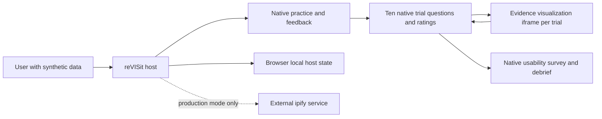

# Cedar Watch synthetic preview design

Status 2026-11-08. The user reports the host-question synthetic preview at commit `69965bfce523f35fe8d6870d56a4df93ed187058`, followed by the deployed direct-entry fix at commit `56f83c87d757e3fa9bc459db483d75b6bfc4ec30`, successful workflow `42527513101`. Root and direct entry returned HTTP 200. This is not a participant-ready study. The preview uses fixed group 0 without randomization, no research consent and browser localStorage only, with no demonstrated central durable save. Earlier single-iframe `pilotSession` designs and the prior Supabase collection proposal are historical, not the current flow. See `plan.md` for historical context and `tasks.md` for outstanding gates.

## Boundary and flow

`public/cedar-watch-pilot/StudyConfig.json` defines a fixed sequence: practice, ten trials, usability survey and debrief. Practice uses a fictional example and host-recorded practice answer with feedback. Each trial is a `website` component using `cedar-watch-pilot/app/visualization.html` for evidence only, while the host renders the question, four answer options including `unknown`, confidence and perceived difficulty as sidebar radios. The survey and debrief are host questionnaires. No consent is requested or recorded; a preview acknowledgement is not consent. The frame is not the owner of the trial questions, ratings, practice or survey, and does not submit the old complete `pilotSession` payload in this design.

Each frame receives `contractVersion: 1`, `trialId`, `scenarioFamily`, `taskVariant`, `condition` and `stimulusSeed: 271828` from the host configuration. The sequence explicitly fixes family, variant and condition to group 0, not participant-hashed assignment. The seed controls stimulus configuration, not random assignment. Baseline and recommended views differ in their displayed evidence presentation. The same pinned child packaging supplies the visualization; `scripts/cedar-watch-visualization.patch` and the build recipe should be reviewed alongside the exact generated artifact when reproducing it. Host and child version compatibility, origin/source checks, frame restrictions and failure behavior still need end-to-end verification.

The existing `IframeController.tsx` has a visualization-specific readiness gate: it initializes stimulus validation as invalid, scopes readiness to the current frame generation and uses checked child readiness messages to update it. This is separate from required native answer gating. It is source-level functionality, not proof that every load, failure, stale message, navigation or refresh path fails closed in the deployed host. Verify those lifecycle paths before collection.

## Data and exports

The host holds separate response IDs for each question and rating, practice, survey and acknowledgement, associated with its own component and participant records. Trial identity and family/variant/condition are in the study configuration and must be joined to the host records using the component and configuration version. An `unknown` value is a response, not an absent answer. Practice is recorded separately and must not be counted as an experimental trial. Visualization selections, interaction samples, and event and timing telemetry are omitted as trial data in this flow. Do not infer attention, active time or selected reports from host responses.

Host exports differ from the standalone child's session JSON/CSV and its analysis schema. They are not a `pilotSession` record and must not be fed to the existing standalone analysis as if equivalent. Before analysis inventory actual exported fields and formats, identifiers, timestamps and host metadata, define and test a versioned mapping to an approved analysis dataset, and report missing interaction and timing fields without inventing them. The local synthetic run did not establish a validated export mapping.

The synthetic preview stores native host answers in browser localStorage, not Supabase or another central durable store. Browser data may be cleared, unavailable or lost, and any downloaded export is a separate copy. Host progression is not evidence of durable saving or recovery. No Supabase configuration, permissions, acknowledgments, identity binding or deployed recovery are demonstrated for this current version. A historical staging project and a proposed Supabase architecture do not change that fact.

## Conditional future collection security contract

No backend implementation or Supabase work is authorized in the current scope. If central collection is separately authorized, the earlier proposed constraints remain design requirements to review and approve, not implemented guarantees. Default deny and least privilege must cover effective database, function and object permissions, not just UI controls. A trusted server must bind an authenticated subject to its study and server-issued participant identity, never authorize using client-supplied IDs, and restrict each participant to their own records. Shared configuration and operator or analyst actions require separate server-enforced roles and auditability. Assignment must be transactional, concurrency-safe and retry-stable. Validated writes and completion need owner checks, revision conflict handling and idempotency, with truthful post-commit acknowledgment and a separately approved recovery policy. Restrict unused storage paths and test direct bypass attempts, cross-user access, concurrency, outages and recovery on isolated infrastructure. Never expose service-role credentials in a browser. The historical tasks describe candidate implementation details which must be reconciled with the then-approved host-owned instrument before any work begins.

## Evidence and limits

`src/components/Shell.tsx` skips the `https://api.ipify.org?format=json` lookup in synthetic-preview mode but retains it in production. Review the production disclosure and any other network traffic before participant use. The observed synthetic run is not proof that production is offline.

An independent tester reports exercising the exact rebuilt `dist` locally over HTTPS in Chromium with synthetic data: practice including a wrong answer, all ten trials, survey and debrief, required-answer gating and iframe contents. All 119 observed requests were same-origin, with no browser errors. Reported checks include 51 host tests and 27 child tests across 5 files; lint and typecheck passed. These are reported results, not rerun for this update, and not a full-suite, failure-path, export or durability guarantee. The earlier mixed-version rehearsal and its ipify request are historical.

The user reports a separate live Pages browser check: the host sidebar displayed the question and controls, and the first trial iframe displayed evidence. Of 73 observed requests none were off-origin or to ipify. A direct-entry 404 was observed before the fix. The user now reports the fix deployed at `56f83c87d757e3fa9bc459db483d75b6bfc4ec30` with successful workflow `42527513101` and root and direct-entry HTTP 200. These are reported results, not independently rerun here. HTTP 200 does not establish correct rendered content, refresh behavior or navigation readiness. The live first-trial check is partial, not a live completion of all ten trials or a substitute for the local exact-build run. Browser, exact tested URLs, artifact digest and detailed reproduction are not recorded here, nor is the first-trial check tied to the fixed deployment. The earlier publication at workflow `42510782417` and commit `d709c1c2d3d6b90e392febfb182e97055e9268db` is superseded. Neither deployment nor testing verifies Supabase isolation or persistence.

The reported direct-entry fix concerns the synthetic-preview publication only. Do not infer that the separate production deployment workflow has the same direct-entry behavior; verify its actual artifact and routing independently if it is ever authorized.

## Risks and milestones

- Preserve both local and partial live evidence and capture artifact digest and provenance. Verify rendered direct entry and refresh at the exact published study URL, including base path and query handling. Complete a live synthetic browser flow and exercise frame contract, missing or incompatible iframe and blocked storage without false progression or data-loss claims.
- Navigation readiness remains a collection-blocking risk despite the existing visualization-specific gate. Test delayed, missing, failed and incompatible frames, stale readiness and back/refresh navigation on the actual host, and verify or remediate the gate to fail closed before collection. The reported answer gating and HTTP 200 checks do not prove lifecycle safety.
- Inventory and compare host exports with the standalone schema, map trial metadata and unknowns, and explicitly flag missing interaction data. Test synthetic exports and analysis before using results.
- Review deterministic group 0, all-first keyed choices, evidence leakage and condition/variant confounding with investigators. Any randomized or counterbalanced design is a separately approved, versioned change, not an existing feature.
- Review external network traffic including ipify, privacy, accessibility and browser support. Determine an approved consent, withdrawal and retention process before participant use.
- If central collection is later authorized, separately decide and implement storage, least privilege, identity, assignment, recovery and honest save messaging, then verify against an isolated backend. The prior Supabase plan is not an implementation. Never expose service credentials in the browser.
- Record artifact provenance and deployment approvals and conduct production-like rehearsal before any new publication or collection. Until scientific, governance, privacy, reliability and release gates pass, use synthetic data only.

The repository lacks `artifacts/proposal.md` and `artifacts/specs.md`, so consistency with them cannot be checked. `README.md` describes the current host-owned preview and the reported deployment timeline. The separate recommender proposal and specs describe a different proposed study and do not override this preview.
