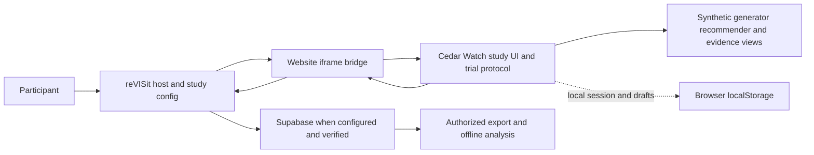

# Visualization study architecture and plan

## Current scope and precedence 2026-11-09

Current direction is documentation reconciliation only, with no code edits and no Supabase work. Source inspection found `scripts/convert-cedar-watch-preview.mjs`, Node tests and a sanitized fixture derived from the actual local synthetic browser `DownloadButtons` analysis-download shape with matching config. The fixture states its responses and behavioral fields are fabricated, timestamps normalized and metadata redacted; it is not a raw exact download or a record of a real participant. Tests were inspected, not executed here, and the capture was not independently reproduced. The supported hash is `80d5196e20bbb0bb176122315bb06619ef0b1aeed87e47ff7a15f4251896d89e`, hardcoded in the converter and fixture and computed by the converter from UTF-8 `JSON.stringify(parsedConfig)`. The config identity does not verify source study namespace; output has `sourceStudyId: null`, `configuredTrial` and `observedExposure: null`. Optional `optionOrders` are checked against configured label/value pairs and `infoText`; a present partial object is conservatively quarantined even when host fallback may render options. Malformed rejection is quarantined, while unexpected internal errors abort rather than masquerade as bad rows. `design.md` specifies these boundaries, timestamp anomalies, limits and the trusted-output-directory assumption.

The unit-test workflow installs with `yarn install --frozen-lockfile` and explicitly runs `yarn test:cedar-export` with Node before Vitest; `vite.config.ts` excludes those Node-native test files from Vitest discovery. The user and README report 22 converter and security tests passed, 4 fixture Vitest tests passed, lint, focused ESLint and typecheck passed. The user separately reports a CLI run on the sanitized fixture's inner array and matching config with 1 accepted, 0 quarantined and no missing responses. The checked-in golden tests the array through the function; the inspected CLI test uses a single record. Neither evidence is real-participant data or an approved analysis. CLI output is pretty-printed UTF-8 JSON with embedded diagnostics; there is no dedicated formatting script in `package.json`. The separate full `yarn unittest run` reports 2113 passed, 1 failed and 1 skipped, with the failure attributed to the preexisting dynamic-fixture expectation at `src/routes/tests/utils.spec.tsx:227`. These results were not independently rerun here, are not a clean full-suite pass and do not establish a successful remote CI run. The earlier 2109-pass report below is a separate historical run, not an additive total.

Historical option #1 candidate reconciliation: the recipe pins `898f8af4ddc54a09e4a5b8d9a7766b78600b6e7c` and applies only `scripts/cedar-watch-testing-library.patch`. The user reports the patch applied, a successful build, 27 child tests and 90 root tests on rerun, plus an independent exact-dist local HTTPS browser pass through all ten trials and survey. These reports were not rerun for this documentation update and do not imply a full suite or candidate live deployment. Prior deployment reports and separately identified tests remain historical baseline evidence. The host-owned fixed-group instrument is a scientific change from the earlier child-owned four-group baseline; preserve that baseline, compare actual candidate source and stimuli, version the differences and obtain investigator review. See `design.md` for restricted overrides, targeted guard and CI, the exact tree-and-patch provenance formula and limits.

Candidate evidence update: the browser run reported no off-origin requests. The full host suite was separately reported as 2109 passed, 1 failed due to a preexisting missing fixture and 1 skipped; separate script tests passed. This is not a clean full-suite pass. Reported build provenance is tree `ecedace4ca3ec38fa74ff7fa5d0d3a0a406cb0fe`, patch SHA-256 `683451099d37f879ff703da2316a8b3f6e33b40fd9b5923fe34db1f19ffed74f`, and fingerprint `898f8af4ddc54a09e4a5b8d9a7766b78600b6e7c+testing-library-72815a6ee6386fcc`, on Linux arm64 with Node 24, npm 11 and Yarn 1. The reported origin was `https://bobthe88.github.io`, host base `/visualization_revisit_study/` and child base `/visualization_revisit_study/cedar-watch-pilot/app/`. The temporary output assembled over host `dist` has manifest digest `93abfa3ec2111171b5d74473455bb231dd263b28b2be58b41bc37a7239437250` for 272 files; child output has digest `fb59158d49e7cd129443afc686aef15d8a4d0cf0dfe3a2972adbd358e9d9b4f6` for 6 files. The reported host base commit `6acb1e3` and dirty non-doc source digest `7ee5d989b3a5fef3f76190c41f95d6283c01663fe842b612bbaf0e127c102333` do not establish a clean commit or deployed artifact. Host source may have changed after building and a future commit must not be equated with the working-tree digest. See `design.md` for the manifest method and the inspected brush interaction requiring scientific review.

The guard CLI now handles script and study paths containing spaces; the user reports 4 guard tests passed, including the CLI case. This was not rerun in this documentation update and does not make the full suite green. The recorded candidate output digest and exact-dist browser evidence predate the final guard source change and do not exactly match the final commit. No new preview was published; rebuild and verify the actual final revision separately before attributing an artifact to it.

The current checked-in `public/cedar-watch-pilot/StudyConfig.json` supersedes the older single-iframe design described in the historical material below. reVISit owns practice with feedback, each of ten trial questions with confidence and difficulty, the usability survey and debrief. Each trial embeds `visualization.html` for evidence only. The fixed sequence is synthetic group 0, seed 271828, not a random or participant-hashed assignment. No research consent is requested or recorded. Host responses and exports differ from the standalone child session JSON/CSV and analysis input; practice is recorded separately, and visualization selections, interaction samples, and event and timing telemetry are omitted as trial data. Storage is browser localStorage only, with no demonstrated central durable save.

Historical baseline reports, not candidate deployment evidence: the user reports deployment of the host-question synthetic preview at commit `69965bfce523f35fe8d6870d56a4df93ed187058`, workflow `42526395126`, followed by the direct-entry fix at commit `56f83c87d757e3fa9bc459db483d75b6bfc4ec30`, successful workflow `42527513101`, with root and direct-entry HTTP 200. An independent tester reported a local HTTPS Chromium run of that earlier exact rebuilt `dist`: practice including a wrong answer, all ten trials, survey and debrief, gating and iframe contents, with 119 same-origin requests and no browser errors. Reported checks included 51 host tests, 27 child tests across 5 files, lint and typecheck. These were not rerun for this documentation update. Separately, the user reports a live Pages browser check showing the host sidebar and first trial evidence iframe, with 73 requests and no off-origin or ipify requests. A direct-entry 404 preceded the fix. The live check is partial and does not establish full live completion or readiness, and is not tied here to the fixed deployment. Browser, exact tested URLs and artifact digest were not provided. HTTP 200 alone does not prove correct rendering or refresh. The earlier mixed-version rehearsal and its ipify request are historical; synthetic-preview mode now skips ipify, while production retains it. No approved research export mapping, durable central save or real Supabase isolation has been established.

Current milestones are: 1. independently review capture provenance, sanitized download-derived fixture, matching config and all-component golden without claiming raw byte identity; 2. independently verify reported checks when authorized, investigate the full-suite failure and skip, and assess additional partial states, timestamp anomalies, optional parameters and option orders, bounds and failure paths; 3. resolve scientific eligibility, exposure, missingness, privacy, access, retention and governance, and independently verify preview provenance, navigation and live failure paths. The converter emits no consent or child telemetry and does not prove observed exposure. Output retains a linkable pseudonym and answers, so protect raw and output copies. Completion does not prove durable save. Any later collection or backend work requires separate authorization. No Supabase work is in scope and no participant collection is authorized.

## Historical plan and evidence

Everything below is preserved as prior context and proposed work, not a description of the current config or a current implementation mandate. In particular references to child-owned consent, practice, trial questions, survey, random four-group assignment, a complete `pilotSession` response, child interaction capture and standalone exports describe the earlier standalone instrument or historical integration. References to Supabase as selected describe a prior collection proposal, not storage demonstrated for the present preview. The conditional security constraints in `design.md` and historical tasks require renewed approval and reconciliation with the current instrument. Conditional future collection work applies only after a new explicit decision. Current scope and evidence above take precedence over any conflicting historical statement below.

Status: updated 2026-11-08 from user direction and repository evidence. The user selected iframe, Supabase and GitHub Pages, and selected Targeting Titan in US East. User-reported empty staging project `cedar-watch-pilot-staging` has ref `kmfvbglotakyakhdunbx`, URL https://kmfvbglotakyakhdunbx.supabase.co, region `us-east-1`, status `ACTIVE_HEALTHY`, and belongs to a free organization. Compute size is unverified. Its random database password was discarded and must be reset if direct database access is needed. Retain the existing Cedar Watch instrument as the working baseline because the intended instrument is otherwise unknown, not as a final protocol decision. The user confirms applicable pilot approvals and certifications; the repository does not independently establish the records. Investigator review and technical release gates remain outstanding. A synthetic preview is deployed, but no participant collection or production readiness is claimed. Use synthetic data only until outstanding gates are met. Paths below are relative to `/root/workspace` unless stated otherwise. `design.md` defines the proposed least-privilege architecture and `tasks.md` tracks evidence and remaining work.

The collection Pages workflow is manually dispatched and not triggered by pushes. Earlier reports of remote divergence, failed deployment with absent configuration, `has_pages=false`, and CI build errors are historical; Pages is now enabled and the synthetic preview is deployed. Investigate the earlier failures, revision divergence and current CI and remote publication settings before collection release. No receipt implementation is included in this update or demonstrated; the mechanism for proving and communicating persistence is an open release decision.

### Authorized synthetic UI-only preview

The user made the repository public and enabled Pages. An earlier synthetic UI-only publication at https://bobthe88.github.io/visualization_revisit_study/ was workflow `42510782417` at commit `d709c1c2d3d6b90e392febfb182e97055e9268db`; its HTTP and bundle checks concern that earlier publication only. The newly reported deployment is identified in current scope above. Neither authorizes participant collection. Publication can replace the existing Pages site and requires explicit intent. Verify controls, base path and exact parent origin for subsequent deployments.

Earlier checks reported the local build passed, 21 child tests passed and the full host suite had 2098 passed, 1 skipped and 1 unrelated failure. The missing Chromium report referred to that earlier attempt. Later local exact-build browser and partial live browser evidence is recorded in current scope above; neither establishes durable persistence or a complete live flow. Investigate the earlier full-suite failure and review publication controls. Open tasks remain in `tasks.md`.

## Evidence and boundaries

- `visualization_revisit_study/README.md` describes the template and draft Cedar Watch integration. Its `AGENTS.md`, `package.json`, `src/parser/types.ts` and `src/controllers/IframeController.tsx` describe the local host and its conventions. `artifacts/proposal.md` and `artifacts/specs.md` are absent in this repository, so consistency with them cannot be verified.
- `adaptive-visualization-recommender/README.md`, `study/README.md`, `study/src/questions.ts`, `study/src/protocol.ts`, `study/src/StudyApp.tsx`, `study/analysis/answer-key.json`, `study/revisit/StudyConfig.json` and its `StudyComponent.tsx` describe the actual Cedar Watch rehearsal. `docs/pilot-study-protocol.md` and `docs/pilot-study-data-dictionary.md` are drafts. The UI revision in the study README and source is newer than the revision mentioned in the protocol, so check the exact frozen source at implementation time.
- `adaptive-visualization-recommender/docs/artifacts/proposal.md` and `specs.md` describe a separate, unimplemented independent paired-review proposal. They are not authorization to replace the Cedar Watch experiment. Their older source and preview observations are historical. The currently inspected `visualization-recommender-study-preview/PREVIEW.md` and workflow instead pin `d717e1196f95b238251af8eba81ec20996b995be`; the deployed artifact and URL behavior were not verified.
- The root app's `src/lib/evaluation.ts` is an older, separate five-scenario local evaluation with its own options, expected answers, correctness and local records. It is not the ten-question study instrument. Neither it nor the public app homepage is an adequate substitute for the study app.

## Actual implemented study instrument

The authoritative wording and option IDs are in `study/src/questions.ts`. Each item offers three choices plus a separately rendered explicit cannot-determine response. The following inventory paraphrases the ten actual prompts, not new questions:

- `corroboration` A: do similar reports establish a count of distinct vehicles? B: which named sources independently report similar counts?
- `conflict` A: interpret the Radio Log Monitor's missing count. B: what do the differing East Depot counts establish?
- `uncertain` A: how long after observation did the Field Report Liaison report arrive? B: what does receipt time imply about observation time?
- `quality` A: was the translated personnel range human verified? B: how should the ambiguous translated range be represented?
- `anomaly` A: does rising report volume establish increased vehicle activity? B: which change is supported by the scripted reports?

Each of the ten prompts has exactly three question-specific options plus the separately rendered unknown option. Each trial also requires confidence from 1 not confident to 5 very confident and perceived difficulty from 1 very easy to 5 very difficult. After all trials, the required survey asks evidence clarity from 1 to 5, preferred view with no-preference option, and easier view with no-difference option. Practice is separate, has practice-only feedback, and is not exported as experimental data. Experimental trials do not display correctness. Unknown is recorded as `answerKind: unknown` with null answer ID, not scored as a blank. The current `study/analysis/analyze.py` lines 179–183 and 247–256 exclude unknown from choice-accuracy denominators and count it separately; lines 228–236 exclude a paired accuracy difference if either answer is unknown. `study/analysis/test_analyze.py` tests this behavior.

**Ordering and leakage gate:** comparison of the offline interpretation key with the rendered source shows the keyed choice is first in all ten items, followed by distractors and then unknown. This is a strong position cue. Decide with investigators whether to retain or deterministically counterbalance choice order, keeping stable option IDs and recording displayed order and seed if changed. Any change is a new version, not a silent preservation claim. Scenario descriptions, recommended-condition rationales and selectable chart cautions can also reveal answers differently across conditions. Review every family, condition and chart, including translation verification, activity versus frequency and distinct-inventory cautions. Decide whether each statement is intended evidence or a hint, document and approve the resulting stimuli. The offline key is outside the study bundle import graph, but it is publicly readable in source and is not secret. Do not conflate synthetic report interpretation with event ground truth.

## Experimental design to preserve unless explicitly changed

The existing draft is within participant: ten trials, five scenario families, one baseline and one recommended condition for each family, with the same synthetic family evidence and different A/B task variants across the conditions. Both provide the report table, observation/receipt timeline, fictional grid and inspector. Recommended adds the actual highest-ranked task-aware chart, rationale and alternatives. A recommendation containing text marks is rendered as the same readable semantic report table used by baseline rather than a Vega text chart; other recommendations use the actual Vega-Lite spec. This fallback is part of the existing stimulus and must be included in condition and leakage review. Practice precedes trials; the survey follows. Assignment hashes a random participant ID into four deterministic groups controlling family order, condition order and variant-condition assignment; it does not guarantee balanced group counts. Preserve and export the assignment, condition, variant, seed `271828`, stimulus and protocol versions, source commit and UI version, and keep refresh/resume consistent. A/B equivalence, learning and carryover are not established, so analyze descriptively and report limitations. Preserve report-level uncertainty, missing values, provenance and no inventory aggregation. No operational or real-person data.

The allocation also has **structural imbalance**, independent of how evenly participants happen to enter the four groups. For example, deriving `conflict` assignments from `study/src/protocol.ts` puts variant A in baseline in three groups and B in baseline in one. Before use, produce an investigator-reviewed family-by-group matrix showing family position, first condition and baseline/recommended A/B variants, with per-family counts and confounding. Investigators must decide whether to retain this allocation with documented limitations or approve a corrected, versioned allocation; neither a silent correction nor a claim of full counterbalancing is acceptable. Freeze and validate the chosen version for new and resumed sessions.

The current `study/analysis/analyze.py` flags incomplete sessions but still includes their submitted trials in condition summaries and includes a family pair if both conditions are present, even when the overall session is incomplete. Before collection and analysis, investigators must separately predeclare eligibility of completed trials from incomplete sessions, within-family pairs from incomplete sessions, complete sessions and withdrawn sessions for each condition summary, paired metric and other outcome. Define withdrawal/deletion cutoffs, unknown responses, denominators, exclusions and reporting. Test each combination and do not represent the current inclusion behavior as an approved policy.

The separate proposed paired-review study instead calls for independent analyst-view and commander-view reviewers of the same case, accept/reject/defer, rationale, defect and stage responses, a versioned case-to-field mapping and independently reviewed rubric. Its proposed minimum of eight cases and 16 paired case reviews is not an approved sample or the existing ten-trial design. If selected later, develop it as a distinct protocol and instrument, not a relabeling of Cedar Watch; implement specs FR-01–FR-14 including independence, equal evidence access, mapping, visibility events, separate rubric and descriptive paired measures. A shared wrong judgment is not correctness. Agreement denominator is eligible pairs; information preservation uses shared decision-relevant rationale fields divided by analyst-identified fields, with zero denominator, coding and missingness rules predeclared. Opened evidence is not proof of comprehension. Confirm cases, variations, assignment, timing and review ownership first.

### Paired-review design if selected

- Coverage matrix: a versioned, advisor-reviewed inventory links each case and version to clean or defective status, collection/provenance, currency/state, translation/grounding and analytic-verdict signals, rubric, field variation, and assigned independent pairs. Demonstrate every approved category and variation is covered, including clean cases with legitimate uncertainty. The proposal's at least eight cases, 16 paired case reviews and at least two paired reviews per selected variation are provisional targets pending advisor confirmation, not established sufficiency or completed recruitment.
- Field mapping: for each claim field record source/evidence reference, analyst presentation, commander explicit/summarized/drill-down representation per variation, summary rule and access path. Validate both reviews receive the same case version and underlying evidence, including drill-down for fields omitted from the overview; flag genuinely absent fields. Capture actual access without claiming attention or understanding.
- Independent assignment: version the allocation rules and persist reviewer, pair, case, case version, view and variation. Enforce different reviewers per pair, no exposure to the other's response, and approved repeat-case and ordering rules. Exercise collision, duplicate, concurrent assignment and incomplete pair behavior; decide central allocation and ownership before implementation.
- Versioned capture: record original judgments and rationales, separately elicited defects and stages including approved no-defect/unsure values, evidence and drill-down events, timestamps, defined active-time and interruption rules, consent/completion/withdrawal and all study, case, mapping, rubric and assignment versions. Preserve raw text and separately coded fields; assign stable IDs and prohibit response leakage.
- Rationale coding: freeze a codebook of decision-relevant fields, coder training, independent coding, disagreement and adjudication procedures, provenance of revisions and handling ambiguous or uncodable rationales. Store coder decisions separately from raw responses and record adjudication; report coder disagreement and missingness.
- Analysis acceptance: freeze pair eligibility, missing and withdrawn records, multiple acceptable rubric judgments, ambiguous cases, variation aggregation and zero analyst-field denominator before scoring. Agreement is identical eligible judgments divided by eligible pairs; report shared incorrect and shared correct separately using each review's rubric. For information preservation, report each pair's shared analyst-identified relevant fields over analyst-identified fields, and explicitly report zero-denominator pairs rather than silently scoring them as complete. Report per-measure numerators, denominators, exclusions and missingness, defect/stage detection and time, case and variation counts. Version the input snapshot, rubric, mappings, coding, analysis script and environment; identical frozen synthetic inputs must reproduce outputs and exclusion reports. Descriptive pilot results do not establish universal or causal requirements.

### Resume and data integrity

The checked-in child overlay routes incomplete standalone resumes through practice. Hosted child recovery is deliberately blocked when a browser already has a saved session because it cannot bind that record to the host participant. There is no demonstrated hosted resume. Synthetic real-host tests must cover reload immediately after consent, during practice and after completed practice, and verify hosted safe-stop behavior. Practice responses remain outside experimental exports. The README reports all 21 child tests passing on the exact pinned overlay, not an end-to-end recovery demonstration.

Currently the UI recomputes trial assignment from participant ID while the session also stores `counterbalanceGroup` and `assignedOrder`. The schema checks order uniqueness and response order but does not prove the stored group and order equal the versioned assignment algorithm or that each trial ID agrees with its family, variant and condition. On every resume and before ingestion, export and analysis validate the entire tuple against the frozen protocol, legal option IDs and assignment. Pin the build for in-progress sessions or define an investigator-approved, versioned, tested migration that preserves assignment, evidence and original records. Unsupported or conflicting versions must stop safely and offer an approved recovery path, never silently recompute a different trial or discard data.

The native adapter receives session changes, including incomplete sessions, but a callback is neither proven durable nor a demonstrated restoration mechanism; it has no documented injection of host-saved session state. Establish an authoritative recovery point and precedence for host snapshots versus local session and per-trial draft, including session identity, revision, submitted-versus-draft boundaries and evidence of the last durable state. If both copies diverge, do not silently overwrite or merge: surface a recoverable conflict and follow a documented investigator-approved resolution. Test fresh-device restore, offline and crash cases and host navigation. Storage fixes exist, but blocked, corrupt or failed reads and writes still require end-to-end failure review; drafts are absent from export. Do not suggest existing export recovers unsaved drafts. Specify and test last durable recovery point, participant warning, retry or safe stop, preservation of recoverable data, and no false success when storage is blocked, full, corrupt or unavailable.

Stored-data concurrency remains a separate risk. `_updateSequenceAssignmentFields` now compares the stored JSON `data` with the value read before updating, and reports a conflict if no row is returned. A mocked test demonstrates detection and a subsequent explicit retry preserving a concurrent change. It does not demonstrate automatic retry or real backend semantics. Verify JSON equality filtering, returned rows and effective RLS on the actual Supabase schema under concurrent writers, and define safe caller-visible conflict handling and retry. Other writes and multi-step operations are not covered by this guard. The child writes session and draft data to localStorage without established cross-tab coordination. Define ownership or concurrency control and test overlapping updates and multiple tabs. Passing storage suites do not prove system-wide race safety.

Reject and undo-reject update participant data and sequence assignments in multiple steps. Scoped rollback handling and local consistency tests include reporting rollback failures, but do not establish atomicity if a write, compensation or concurrent operation fails. Specify a backend-appropriate atomic operation or observable, recoverable reconciliation, and exercise each failure and rollback boundary including reused assignments and concurrent writers. Audit remaining Supabase mutations and storage mutation call sites for ignored errors and unawaited outcomes, propagate failures and avoid false success. Both tasks remain open.

Current offline validation in `analyze.py` verifies some fields, order and uniqueness but accepts any string choice ID and does not reconstruct the assigned family/variant/condition from participant ID or cross-check all CSV rows for the same session. Invalid choices can therefore be mis-scored as incorrect. Define version-specific validation at ingestion, export and analysis: validate schema and supported versions, session identity, trial identity scoped to its session, assignment algorithm and seed, group, exact order, trial tuple, valid answer IDs, CSV row consistency and source/stimulus compatibility. A trial ID is reused across participants by design; identify a logical trial with `(sessionId, trialId)` and optionally enforce `(sessionId, trialIndex)`, not global trial-ID uniqueness. Session IDs identify sessions; the permissible number of sessions per participant is an open protocol decision. Decide repeat participation, linkage and duplicate/restart treatment explicitly; do not enforce global participant-ID uniqueness as a substitute. Reject or quarantine forged, mismatched, duplicated composite keys or unsupported records with reason and audit trail before scoring; never silently repair. Validate the same constraints in both JSON and CSV with adversarial fixtures, including legitimate repeated trial IDs across distinct sessions and policy-compliant participant cardinality. Validation detects inconsistencies, not the authenticity of a malicious client; collection still needs appropriate access controls.

## Proposed architecture

Use the selected iframe path and retain Cedar Watch as the working baseline pending investigator review. Existing packaging is partial, not a demonstrated secure or durable end-to-end deployment. Native integration is a fallback only if the user revisits the selection. Paired review is a separate possible future protocol, not a current replacement. Do not duplicate the trial flow or add a generic layer. The diagram shows the intended hosted path, not verified persistence.

For the Cedar Watch path only, reVISit owns host navigation and, if approved and proven, central persistence; the study owns consent/practice, child trial assignment, trials and survey. The proposed backend separately owns the host sequence assignment and participant binding as described in `design.md`. The existing native adapter passes the whole JSON session under reactive response ID `pilotSession`, with `status` false until ten trials and survey complete. It imports the real shared code, not the root homepage. Its README pins upstream v2.4.4 commit `fb7b64f6ea729ee3d5a0457224326b40ce119176`, specifies Vite aliases and build commit definition, and states the complete host was not run. Compatibility with this local checkout must be tested, not assumed. Confirm how incomplete sessions, decline, exit, host refresh and persistence behave before treating this callback as a complete storage contract. The paired-review path needs its own approved UI and contracts and is not assumed to use this adapter unchanged.

Native fail-closed gate: the local `src/controllers/ReactComponentController.tsx` calls `clearStimulusValidation` for an unresolved component and caught runtime errors; despite its name this sets stimulus validation `status: true` with empty values. Therefore the adapter's own `status: false` does not by itself guarantee that the host cannot advance after failure. Before native use, remediate the host or use an approved fail-closed mechanism that leaves missing, failed or not-yet-loaded required stimuli invalid, gives a recoverable error and does not erase a durable response. Test missing module, load failure including a whole-build failure where applicable, runtime exception before and after partial progress, and reload/recovery including stale valid state. The component glob is eager, so failures may occur at build or page load rather than as an asynchronous import rejection; test the actual pinned host paths. No advancement or fabricated completion on error; only a validated complete response may unblock progress. Confirm error behavior in production-like host E2E, not only mocked controller tests.

The configured `website` component loads the same-origin built app and declares reactive `pilotSession`. `IframeController.tsx` provides `trialid`, iframe ID and parent origin for relative and absolute URLs, sends to the expected origin, checks message origin, source and ID, and cleans up its listener. It sends `STUDY_DATA` on ready. For Cedar Watch it only accepts a JSON string with a checked complete ten-trial and `usability` shape before marking the stimulus valid. This is partial structural validation, not full assignment, legal choice, replay or security validation. The overlay supplies child-side trusted-origin and referrer checks. Source inspection and mocked tests do not establish end-to-end compatibility or authorization.

Complete and verify a versioned bridge contract on the actual host: retain exact origin and source checks and explicit target origin, add or prove full version, shape, size, assignment, legal ID and lifecycle validation, replay handling and safe restoration if approved. Host acceptance is not a durable acknowledgment. Define reload, timeouts, duplicate and stale messages, disconnects and recovery. ID is correlation, not authentication. Check CSP `frame-ancestors`, X-Frame-Options, HTTPS, frame sandbox permissions, storage restrictions, CORS where applicable, resizing, keyboard focus and failure messaging. Preserve decline and never send premature completion.

The child requires an exact configured parent origin matching the referrer. Production builds accept HTTPS origins only and explicitly disable HTTP loopback. Vite development permits HTTP loopback only with an exact loopback parent allowlist entry and explicit opt-in. No real host/dev-server loopback flow has been verified, and an absent or mismatched trusted origin disables the bridge.

## Data contracts and operation

- Current local model: session has schema/protocol/UI/source/stimulus versions, pseudonymous participant and session IDs, consent flag, four-group assignment and trial order, status, trial responses and three survey answers. Trial fields include family, A/B, condition, recommended and selected visualization, selected reports and interaction events, answer kind/ID, confidence, difficulty, active time and visibility interruptions. The session and per-trial drafts use localStorage; drafts are excluded from exports. No central upload exists in standalone mode.
- For hosted Cedar Watch collection propose reVISit as authoritative owner of a versioned validated session payload under `pilotSession`, with session IDs and composite `(sessionId, trialId)` logical trial identifiers. Choose participant-to-session cardinality, how partial updates, completion, consent and withdrawal are persisted, and document exact host storage semantics before implementation. Do not assume a callback or message is a durable acknowledgment. Decide how durable persistence is evidenced and communicated, including whether a receipt is needed, alongside retries with stable idempotency keys or equivalent unique constraints, one logical submission on replay, recovery and conflict policy. Never show an unverified saved state. If the selected backend cannot satisfy the approved data-loss and recovery requirements, resolve that gap before launch rather than add an unapproved second database.
- A research data dictionary must map source fields to host storage and exports, including host-added browser/device or network metadata, event timing and incomplete or unknown states. Avoid names, emails, operational data and identifiers in URLs or logs. Preserve raw responses; keep keys/rubrics and derived scores separately. Pilot and live records require isolation and access control. The current standalone study offers participant-initiated JSON/CSV downloads; whether hosted collection retains participant downloads or restricts exports to authorized analysts is an unresolved investigator and institution decision, not an existing approved analyst-only policy. Specify access, encryption in transit and at rest, roles, retention, deletion, backups and their limits, incident response and withdrawal behavior. Local storage is not a central research database; third-party browser policies may block it. Static hosting is not persistence.

Deletion and withdrawal must not be conflated. Clearing the study's browser-local session and drafts affects only that browser; clearing host-side local state is a separate action whose exact scope must be verified. Neither proves deletion from an approved central store or backups. Withdrawal is a protocol-governed request and eligibility status, not automatically a deletion operation; specify how it is requested, verified, recorded and acted on, including time limits and whether already deidentified data can be found. Central deletion requires an authorized, auditable operation and defined backup retention. JSON/CSV copies already downloaded to a device or exported to analysts are separate copies that may not be remotely retractable; consent and debrief must explain the practical limits. Do not promise more than the approved process can perform.

## Dependencies and deployment

Historical recipe, not the current candidate: an earlier build fetched `4b6927b12d212f139d003348b79c912a991bdb8b` and used multiple overlays. The current candidate recipe and exact fingerprint are stated in the current scope and `design.md`. A source override requires explicit review. Capture host commit, lockfiles, tool versions, settings and artifact digest; the fingerprint alone does not prove deployment or reproducibility.

The collection Pages workflow is dispatched on `main`; pushes and separate CI do not publish through it. It targets `github-pages` and requires the Supabase URL Actions variable and anon-key Actions secret. Earlier reports of a deploy failure with configuration absent, `has_pages=false`, CI build errors and remote `main` differing from local are historical; Pages is now enabled and the synthetic preview was published. Investigate earlier failures and current CI and reconcile revisions safely before relying on collection workflow behavior remotely. Before dispatch, verify the intended revision, site, base path, exact approved origin and matching project values; afterward verify the deployed artifact and URL. Establish a separate staging site or repository and a verified manual deployment process before staging, since the existing workflow targets one site. Choose, configure where required, and verify environment approvals, branch restrictions and reviewers in repository settings. They are not claimed configured. Remote observations were not independently rechecked for this update.

Supabase is the chosen backend. The workflow requires URL and anon key and sets the engine to Supabase, while local builds retain local storage by default. Scoped host changes and mocked safety tests cover download error classification, anonymous sign-in and initialization failures, returned errors for participant completion, sequence assignment creation and config-hash updates, and assignment compare-and-set conflict detection. They do not demonstrate durability or an exhaustive mutation audit. The reVISit engine uses a `revisit` table and storage bucket. The reported empty staging project is not configured study storage or verified access policies or RLS behavior. Deployment and backend verification require implementation, approved deployment origins and staging configuration. Test schema compatibility, JSON equality and returned-row behavior, permissions, persistence, acknowledgment, export, deletion and recovery in isolated staging. Never put service-role credentials in the browser or client-exposed variables. Request approval before adding dependencies. The child has its own npm lockfile and build.

There is also a source migration at `adaptive-visualization-recommender/supabase/migrations/20261106152703_create_cedar_watch_pilot_tables.sql`. It declares session, trial and ordered interaction tables, primary/foreign keys, checks and indexes, enables row-level security, revokes all access from `anon` and `authenticated`, and grants service-role access. It intentionally enables no participant-facing access and does not provide a client collection path. Its constraints alone do not validate the full versioned assignment or answer IDs. This is an inventory of source, not evidence that the migration was applied, a database exists, reVISit uses these tables, or permissions are approved. Compare it with the selected host storage model before reuse, and never expose the service-role credential in a browser.

## Risks, tests and launch gates

- Integration: incompatible React aliases, host versions, iframe handshake, frame headers and third-party storage can fail or change study behavior. Test the real production-like host with pinned builds and explicit failure UI.
- Reliability and performance: a whole-session payload grows with interactions; test size limits, save latency, network interruption, retries, quotas and long sessions on target devices. Define availability and acceptable data-loss targets before selection. Avoid logging unbounded or unnecessary interactions.
- Scientific validity: all-first keys, text leakage, variant difficulty, repeated exposure, uncontrolled ordering and offline imbalance threaten inference. Review the full rendered stimuli and predefine versioned analysis and deviations; no causal, population or power claims from feasibility alone.
- Security and ethics: investigate origin spoofing, frame navigation, malformed/replayed messages, data exposure, authorization and retention. The user confirms applicable pilot approvals and certifications, but investigator/contact, consent/debrief, recruitment, withdrawal, governance and live-release authorization remain to be documented as applicable. Until outstanding gates pass, synthetic rehearsal only and no human-performance claims.
- Test using synthetic records: for Cedar Watch if selected, unit tests for assignment, stable option order if approved, validation, unknowns, completion, timing and serialization; integration tests for host callback or message contract, invalid origin/source/schema, answer IDs, restart and persistence; browser E2E for consent/decline, practice, ten trials, survey, keyboard/screen reader and supported viewport, failure/retry, resume, export, delete and no early advancement. Verify equal evidence and per-condition text; exercise the chosen backend in isolated staging. For paired review, test its separate protocol and independent assignment as specified above. Pin test fixtures and compare exports to analysis. Set browser, accessibility and performance targets with owners.

### Existing test anchors and gaps

- Cedar Watch `study/tests/protocol.test.ts` covers repeatability, group reachability, unknown and draft serialization, some invalid choices and order. Extend with all four exact assignments, forged group/order/tuple and unsupported versions, resume compatibility and migration. Existing coverage is not proof that these checks exist.
- `study/tests/study-app.test.tsx` covers decline, condition rendering, text-mark detection and draft resume. Extend real-host practice reload and hosted safe-stop checks, corrupt/blocked/full localStorage, host/local conflict and text-table fallback coverage. An earlier report recorded child typecheck, 21 tests across 3 files and scripted artifact build passing, with large-chunk and Zod annotation warnings. Historical fingerprint: `4b6927b12d212f139d003348b79c912a991bdb8b+bridge-224bc56c6af4a0eb`; do not attribute it to a later historical five-overlay build or the current single-patch candidate. These are reported results, not runs performed in this update. `study/e2e/rehearsal.test.mjs` is standalone synthetic Chromium coverage; a skip is not a pass.
- `study/analysis/test_analyze.py` covers unknown denominator and some order checks. Add JSON/CSV forged option ID, group, assignment, trial tuple, duplicate IDs, mixed session rows, incompatible versions and quarantine tests with valid version-specific fixtures. Existing synthetic test data must be updated where they do not obey the real assignment algorithm.
- reVISit `src/controllers/tests/IframeController.spec.tsx` contains mocked wrong-origin/source rejection, exact target origin, URL and pilot completion-shape cases. Latest user-reported checks: 134 storage tests passed, as did lint and typecheck. Earlier reports recorded 184 targeted storage tests and 14 targeted iframe tests. These are separate runs, not additive or a full-suite claim. Mocks and storage suites are not proof of production security, real backend reliability or migration deployment. Extend replay, malformed payload, assignment, legal answer, lifecycle and actual-host coverage. Follow `AGENTS.md`; do not run `yarn test` directly.
- Earlier browser E2E was skipped when Chromium was missing. The later exact `dist` local HTTPS Chromium flow and partial deployed-live check are described in current scope; full live flow and rendered direct-entry and refresh verification remain outstanding despite reported HTTP 200. No configured Supabase collection deployment, secure effective RLS, durable acknowledgment or hosted resume has been demonstrated. The historical full host suite reported 2098 passed, 1 skipped and 1 unrelated failure. These are reported results, not runs performed in this update.
- If paired review is selected, build separate case coverage, mapping, assignment, independent-review, coding/adjudication and reproducible-analysis suites; the ten-trial Cedar Watch suites are not a substitute.

## Open decisions and milestones

The user owns decisions and confirms applicable pilot approvals and certifications. Iframe, new study-owned hosted Supabase projects and GitHub Pages with manual publication are selected; Cedar Watch remains only the working baseline until investigator review. Outstanding decisions include final protocol and changes, ordering and leakage, allocation, sample, participant-to-session cardinality, analysis eligibility, exports, consent and withdrawal, accessibility targets, project/data ownership, recovery semantics, persistence evidence and whether a receipt is needed, exact Pages targets and origins, environment protections, retention and launch authority. No receipt is implemented by this planning update. The repository does not independently establish approval records or authorize live collection.

1. Record the deployed synthetic preview and its limited verification, investigate remaining preview and CI gaps, and coordinate investigator review of the Cedar Watch baseline, leakage, ordering and allocation.
2. Complete and exercise the selected iframe contract on the actual host using synthetic records.
3. Resolve remote revision divergence, CI build errors and missing deployment configuration. Resolve residual conflicts, reject rollback atomicity and ignored mutation outcomes. Configure the existing isolated Supabase staging project and approved deployment origins, then verify compare-and-set semantics, access, durable persistence and the user-approved recovery approach.
4. Complete end-to-end, scientific, accessibility and security rehearsal with reproducible exports.
5. Record applicable approval conditions and obtain any remaining investigator and deployment-owner release authorization before an approved live deployment. See `tasks.md` for dependencies and acceptance criteria.

Release gates are conjunctive: documented scientific and governance decisions, independent verification of chosen manual deployment controls, isolated staging authorization and persistence tests, real-host synthetic rehearsal, an approved and verified recovery and truthful completion approach, and explicit release authority. If any gate is unmet, retain synthetic-only use and do not collect participant data. A synthetic staging publication is not live release approval.
